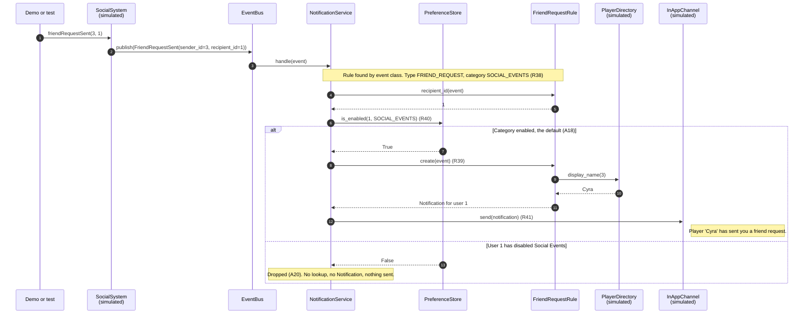
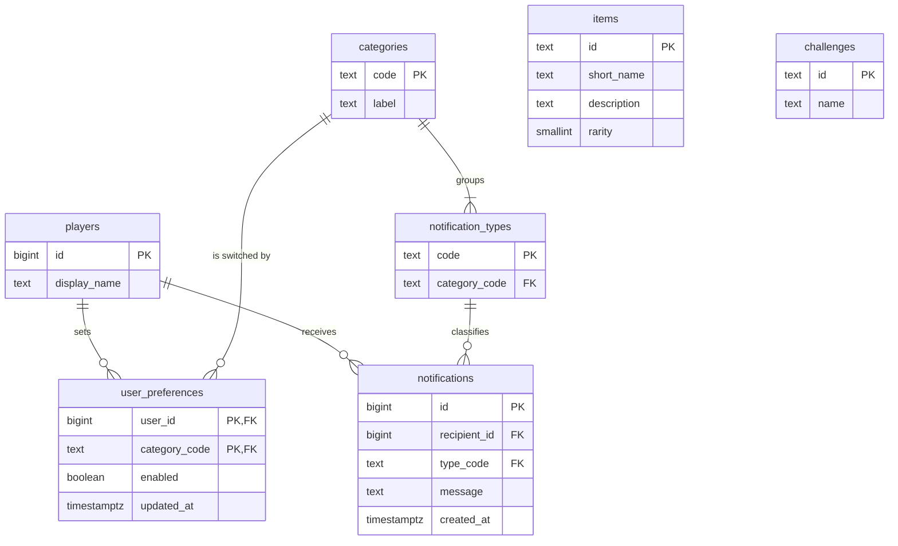
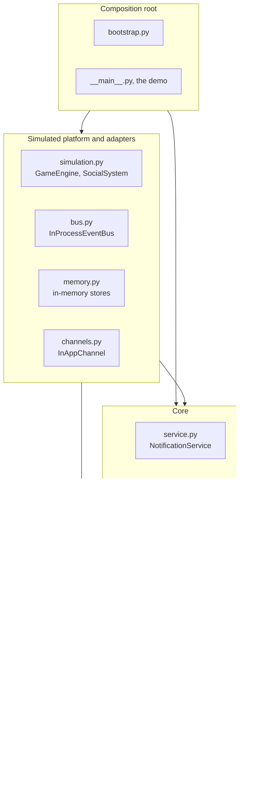

# Architecture: real-time notification system

**Version 1.0. Status: PROPOSED (2026-10-07).** Nothing here is confirmed, and no code should be written from it until it is. It builds on [requirements.md](requirements.md) version 1.1 and uses its IDs. New IDs in this file: AD1 to AD8, the architecture decisions.

What this design does to the requirements:

- It changes no PROPOSED assumption.
- It confirms the proposal inside A7: preferences are checked before the `Notification` is created (AD3).
- It settles three details that version 1.1 left to this step: the `Notification` fields (A1) and the item attribute (A10) in section 4, and the Docker commands (D2) in section 9.

Status words used below: **BUILT** is real code in today's build. **SIMULATED** is built as a small in-memory stand-in for something the platform owns (N2, N5). **EXTENSION** is a seam the design leaves open. It is not built.

## 1. Summary

The system is event-driven and runs in one process.

1. `GameEngine` and `SocialSystem`, both simulated, turn each trigger into an event object and publish it on an event bus.
2. `NotificationService` subscribes to the bus. For each event it finds the rule registered for that event class. The rule fixes the notification type and its category.
3. The service asks the rule who the recipient is and checks that player's preference for the category.
4. If the category is enabled, the rule creates the `Notification`, looking up names and items through interfaces.
5. The service sends it through each configured channel. Only the simulated in-app channel is built.

Everything the service depends on is an interface with an in-memory implementation, wired in one place. Python standard library only, run in Docker.

| Pattern | Where | Why |
|---|---|---|
| Publish-subscribe (observer) | `EventBus` | Emitters do not know who listens (R36). |
| Strategy with a registry | One `NotificationRule` per event class | A new event type is an addition, not an edit (R34). |
| Ports and adapters (dependency inversion) | Interfaces in `ports.py`, in-memory adapters | Stores, lookups and channels can be replaced without touching the core. |
| Dependency injection with one composition root | `bootstrap.py` | One place decides what is real and what is simulated. |

## 2. Quality goals

In priority order.

| # | Goal | Source | How the design meets it |
|---|---|---|---|
| 1 | Extensibility | R34. R12: “hypothetical scenarios on what will imply adding features” | New event types, categories and channels are added beside existing code. Section 8 lists each case. |
| 2 | Modularity | R33: “interfaces, services, and classes”. R36 | Emitters, bus, dispatch, lookups and delivery are separate modules that meet only at interfaces. Dependencies point one way (section 7). |
| 3 | Simplicity | R2. A4: the deadline is today | One process, standard library only, about ten small modules. Database, queue, extra channels and PvP are seams, not code. |
| 4 | Maintainability | R34 | Everything about one event type lives in one rule. Types and categories are enums. Requirement IDs appear in comments and tests. |
| 5 | Testability | A28, R7 | Every dependency is injected and the bus is synchronous, so a test fires a trigger and reads what the channel recorded. |
| 6 | Real-time delivery | R14, R15, A21 | The path from trigger to channel is one synchronous call chain, with no batching, scheduling or polling. Delivery to the client itself is assumed (N2). |

## 3. Options and decisions

| | Option 1: direct calls into one service | Option 2: event bus with a rule per event type |
|---|---|---|
| How an event arrives | `GameEngine` calls a method on the notification service | Emitters publish an event object. The service subscribes. |
| Coupling | Emitters import and know the notification service | Emitters know only the bus and the event classes |
| Adding an event type | Edit the service: a new method or a new `if` branch | Add an event class and a rule. The service is untouched. |
| Other consumers of the same events | Every emitter must call them too | They subscribe. Emitters are untouched. |
| Moving to a queue or many instances | Rewrite the call sites | Replace the bus implementation |
| Fit with R35 and R36 | Weak. Nothing is captured; it is a method call. | Direct: “capture these events and pass them to your notification system” |
| Cost today | Smallest | A small bus and one small class per event type |

**Chosen: option 2.** It costs a little more code today and is the only one of the two where the section 8 scenarios are additions. Option 1 is the right answer only if the system never grows, and R34 says it will.

| ID | Decision | Options | Choice | Why | Trade-off |
|---|---|---|---|---|---|
| AD1 | Overall style | Direct calls into one service. An in-process event bus with a rule per event type. | The event bus with rules (option 2). | R35 and R36 ask for events to be captured from different parts and passed on. Emitters stay unaware of notifications. | One more hop to follow when reading or debugging. |
| AD2 | How the bus delivers | Synchronous and in-process. An in-process queue with a worker. An external broker. | Synchronous, behind the `EventBus` interface. | It meets A21 and A26 in a few lines, and tests are deterministic. | A slow subscriber delays the emitter, and an event is lost if the process dies. Both are acceptable under A24 and A26. |
| AD3 | Dispatch order (A7) | The brief's order: type, create, check, send. Or: type, check, create, send. | Type, check preferences, create, send. This confirms the proposal in A7. | The check needs only the recipient and the category, and both are known once the rule is found. A blocked notification then costs no lookups and no object, which matters once lookups are remote calls. All four steps still happen. | It differs from the order of the brief's sentence, so the README must say so. If preferences later become per channel, a second check per channel comes after creation. Going back means moving one line in `NotificationService.handle`. |
| AD4 | Where event-specific logic lives | An `if` chain in the service. A rule class per event type. A data table of templates. | One `NotificationRule` class per event type, registered by event class in `rules.default_rules()`. | Type, recipient, condition and text for one event sit together, and the service never changes when an event type is added. | Six small classes instead of one function. A data table would be shorter but cannot express the item's rarity condition or the lookups. |
| AD5 | How parts find each other | Concrete classes created where they are used. Interfaces with constructor injection. | Interfaces in `ports.py` (abstract base classes), injected through constructors and wired only in `bootstrap.py`. | R33 names interfaces. Tests pass fakes. A database or a real client replaces an adapter without touching the core. | More names than the demo strictly needs: six interfaces for six small adapters. |
| AD6 | Storage | A database now. In-memory stores behind the interfaces. | In-memory. A23 stands (R30). | The brief allows a simple dictionary or map, and nothing has to survive a restart. | Nothing is kept. Section 6 gives the schema the stores would map to. |
| AD7 | Delivery | Print straight from the service. A `NotificationChannel` interface. | The interface. The service holds a list of channels with one entry, `InAppChannel` (R24). | The client is an outside dependency that the brief says can be mocked (R45). A list makes a second channel one new class and one line of wiring. | A loop over one element today. |
| AD8 | Types and categories | Free strings. Enums. | Enums. Each `NotificationType` carries its `Category` (A6, A17). | A misspelt type or category cannot exist, and the category check needs no extra table. | Adding one is a code change, not configuration. |

## 4. Entities

| Entity | Purpose | Main attributes | Relationships | Status |
|---|---|---|---|---|
| Player | A user of the platform. Receives notifications and appears by name in other players' messages (A12). | `id: int`, `display_name: str` | Has preferences, receives notifications, acts in events. | SIMULATED. `PlayerDirectory` maps id to name. No `Player` class is needed yet. |
| Game | One of the platform's games. | `id: str`, `name: str` | Would own events through a `game_id` on `Event`. | EXTENSION. **Conflict with A27: A27 stands.** No trigger carries a game, so the field would be a value nobody sets. The seam is an optional `game_id` on `Event`. |
| Game engine | Stand-in for the part of the platform that emits game events (A8, N5). | `bus: EventBus` | Publishes `PlayerLeveledUp`, `ItemAcquired`, `ChallengeCompleted`. Knows nothing about notifications. | SIMULATED |
| Social system | Stand-in for the part that emits social events. | `bus: EventBus` | Publishes `FriendRequestSent`, `FriendRequestAccepted`, `FollowerAdded`. | SIMULATED |
| Event | An immutable fact from the platform. One frozen dataclass per event type. | `PlayerLeveledUp(user_id: int, level: int)`<br>`ItemAcquired(user_id: int, item_id: str)`<br>`ChallengeCompleted(user_id: int, challenge_id: str)`<br>`FriendRequestSent(sender_id: int, recipient_id: int)`<br>`FriendRequestAccepted(accepter_id: int, requester_id: int)`<br>`FollowerAdded(follower_id: int, followed_id: int)` | Published by an emitter, carried by the bus, matched to one rule by its class. | BUILT. The two PvP events are an EXTENSION (D4). |
| Event bus | Carries events from emitters to subscribers (R35, R36). | `subscribers: dict[type[Event], list[Callable]]` | Emitters publish. `NotificationService` subscribes. | BUILT, synchronous (AD2) |
| Queue | Would buffer events between emitters and the service. | Not designed in detail. | Would sit behind `EventBus`. | EXTENSION. **Conflict with A26: A26 stands.** The synchronous bus already meets A21, and a queue raises ordering, retry and duplicate questions that A24 says are not built. The seam is the `EventBus` interface. |
| Notification rule | Everything specific to one event type: its notification type, who receives it, whether it qualifies, and the text. | `event_type: type[Event]`, `notification_type: NotificationType` | One per event type. Uses the lookups. Creates the `Notification`. | BUILT, six rules |
| Notification service | Runs the same dispatch steps for every event (R38 to R41). | `rules: dict[type[Event], NotificationRule]`, `preferences: PreferenceStore`, `channels: list[NotificationChannel]` | Subscribed to the bus. Uses rules, preferences and channels. | BUILT |
| Notification | The message for one player. The project's own basic class (A1). | `recipient_id: int`, `type: NotificationType`, `message: str`, `created_at: datetime`. `category` is read from `type`. | Created by a rule, sent by a channel. | BUILT |
| Notification type | Names the kind of notification (R38, A6). | Enum: `LEVEL_UP`, `ITEM_ACQUIRED`, `CHALLENGE_COMPLETED`, `FRIEND_REQUEST`, `FRIEND_ACCEPTED`, `NEW_FOLLOWER`. Each has `category: Category`. | Belongs to exactly one category. | BUILT |
| Category | What a player can switch on or off (R29, A17). | Enum: `GAME_EVENTS` labelled "Game Events", `SOCIAL_EVENTS` labelled "Social Events". | Groups notification types. Keys preferences. | BUILT |
| User preferences | On or off per player and category. On by default (A18). | `user_id: int`, `category: Category`, `enabled: bool` | One player, one entry per category. | BUILT as a `dict` behind `PreferenceStore` (R30) |
| Item | A game item (A10, A11). | `id: str`, `short_name: str`, `description: str`, `rarity: Rarity`.<br>`Rarity` is an ordered enum: `COMMON`, `UNCOMMON`, `RARE`, `EPIC`, `LEGENDARY`. | Looked up by `ItemAcquiredRule`, which notifies from `RARE` up and puts the rarity word in the message. | `Item` is BUILT. The catalog is SIMULATED. |
| Challenge | A quest or achievement (A13). | `id: str`, `name: str` | Looked up by `ChallengeCompletedRule`. An unknown challenge is shown by its id, as A25 does for players. | SIMULATED catalog |
| Delivery channel | A way to reach the player (R24, R41). | `send(notification)` | The service sends to every configured channel. | `InAppChannel` is SIMULATED (R45): it prints and records. Email and push are EXTENSIONS (N3). |

## 5. Interactions

| # | Who | Does what | To whom | What happens next |
|---|---|---|---|---|
| 1 | `bootstrap.build_app()` | Creates the stores, bus, rules, channel and service, and subscribes the service for every rule's event class | `EventBus` | The system is ready. Nothing is wired anywhere else. |
| 2 | Demo or test | Calls a trigger, for example `playerLeveledUp(1, 15)` | `GameEngine` or `SocialSystem` | The stand-in builds the matching event. |
| 3 | `GameEngine`, `SocialSystem` | Publish the event | `EventBus` | The bus calls every subscriber of that event class, in order, before `publish` returns (A21). |
| 4 | `EventBus` | Passes the event | `NotificationService.handle` | The service picks the rule for the event's class. That fixes the type and the category (R38). An event with no rule is ignored. |
| 5 | `NotificationService` | Asks for the recipient, then asks whether the category is enabled | The rule, then `PreferenceStore` | Disabled: the event is dropped and logged as skipped (A20). Enabled: step 6 (R40). |
| 6 | `NotificationService` | Asks for the notification | The rule | The rule looks up what the text needs and returns a `Notification` (R39). It returns nothing if the event does not qualify: an item below `RARE`, or an unknown item (A10, A25). |
| 7 | `NotificationService` | Sends the notification | Each `NotificationChannel` | `InAppChannel` prints it and records it (R41, R45). The outcome is logged. |
| 8 | Demo or test, standing in for a player | Switches a category off or on | `PreferenceStore` | Later events in that category follow the new setting (R29, A19). |

`socialSystem.friendRequestSent(3, 1)`, with both outcomes. Cyra is the sample name of user 3.



## 6. Data model

**The build uses in-memory stores behind interfaces, not a database.** A23 stands, and R30 allows a dictionary. The schema below is what those stores map to when a database is added (section 8). Types are PostgreSQL.

| Interface or class | In memory today | Table later |
|---|---|---|
| `PreferenceStore` | `dict[int, dict[Category, bool]]` | `user_preferences` |
| `PlayerDirectory` | `dict[int, str]` | `players` |
| `ItemCatalog` | `dict[str, Item]` | `items` |
| `ChallengeCatalog` | `dict[str, Challenge]` | `challenges` |
| `Category`, `NotificationType` | Enums | `categories`, `notification_types` |
| `Notification` | Not kept (A20, A23) | `notifications`, only if history is added |

| Table | Columns | Keys and relationships |
|---|---|---|
| `players` | `id BIGINT`, `display_name TEXT NOT NULL` | PK `id`. Owned by the platform and only read here. |
| `items` | `id TEXT`, `short_name TEXT NOT NULL`, `description TEXT NOT NULL`, `rarity SMALLINT NOT NULL` (0 common to 4 legendary) | PK `id`. Owned by the game and only read here. |
| `challenges` | `id TEXT`, `name TEXT NOT NULL` | PK `id`. Owned by the game and only read here. |
| `categories` | `code TEXT`, `label TEXT NOT NULL` | PK `code`. Rows: `GAME_EVENTS`, `SOCIAL_EVENTS`. |
| `notification_types` | `code TEXT`, `category_code TEXT NOT NULL` | PK `code`. FK `category_code` to `categories.code`. |
| `user_preferences` | `user_id BIGINT`, `category_code TEXT`, `enabled BOOLEAN NOT NULL`, `updated_at TIMESTAMPTZ NOT NULL` | PK (`user_id`, `category_code`). FKs to `players.id` and `categories.code`. No row means enabled (A18). |
| `notifications` | `id BIGINT` identity, `recipient_id BIGINT NOT NULL`, `type_code TEXT NOT NULL`, `message TEXT NOT NULL`, `created_at TIMESTAMPTZ NOT NULL` | PK `id`. FKs to `players.id` and `notification_types.code`. Index on (`recipient_id`, `created_at`). An inbox would add `read_at`. |



`items` and `challenges` have no foreign keys: events carry their ids, and nothing in the notification tables points at them.

## 7. Modules

```text
notification-system/
├── Dockerfile                  python:3.13-slim; the default command runs the demo
├── build, run, test scripts    one line each, as .sh and .cmd (section 9, D2)
├── README.md
├── notification_system/
│   ├── domain.py               Category, NotificationType, Notification, Rarity, Item, Challenge
│   ├── events.py               Event and the six event dataclasses
│   ├── ports.py                the six interfaces
│   ├── rules.py                NotificationRule, the six rules, default_rules()
│   ├── service.py              NotificationService
│   ├── bus.py                  InProcessEventBus
│   ├── memory.py               the four in-memory stores
│   ├── channels.py             InAppChannel
│   ├── simulation.py           GameEngine, SocialSystem
│   ├── bootstrap.py            build_app(): the only place that wires things
│   └── __main__.py             the example usage (R42, R43)
└── tests/                      unittest: the four PDF triggers, preferences, item rarity
```

| Interface | Methods | Built implementation | Used by |
|---|---|---|---|
| `EventBus` | `subscribe(event_type, subscriber)`, `publish(event)` | `InProcessEventBus` | `GameEngine`, `SocialSystem`, `bootstrap` |
| `PreferenceStore` | `is_enabled(user_id, category)`, `set_enabled(user_id, category, enabled)` | `InMemoryPreferenceStore` | `NotificationService`, demo, tests |
| `ItemCatalog` | `get(item_id)` returns an `Item` or `None` | `InMemoryItemCatalog` | `ItemAcquiredRule` |
| `PlayerDirectory` | `display_name(user_id)` returns the name, or the id as text (A25) | `InMemoryPlayerDirectory` | The three social rules |
| `ChallengeCatalog` | `get(challenge_id)` returns a `Challenge` or `None` | `InMemoryChallengeCatalog` | `ChallengeCompletedRule` |
| `NotificationChannel` | `send(notification)` | `InAppChannel` | `NotificationService` |
| `NotificationRule` (in `rules.py`) | `event_type`, `notification_type`, `recipient_id(event)`, `create(event)` returns a `Notification` or `None` | The six rules | `NotificationService` |

**Dependencies point inward only.** `domain.py` and `events.py` import nothing from the project. The core (`ports.py`, `rules.py`, `service.py`) imports only the domain. Adapters and the simulated platform import the core's interfaces and the domain, never each other. `simulation.py` imports only `EventBus` and the event classes. Only `bootstrap.py` and `__main__.py` import everything, and nothing imports them.



## 8. Extension scenarios

None of these is built. Each row is the answer to "what would it take".

| Scenario | What changes | What stays untouched |
|---|---|---|
| A new event type | `events.py`: one event class. `domain.py`: one `NotificationType` member. `rules.py`: one rule class and one line in `default_rules()`. `simulation.py`: one trigger method (in production the platform already emits the event). One test. | `service.py`, `bus.py`, `ports.py`, `memory.py`, `channels.py`, `bootstrap.py` and every existing rule. |
| A new category | `domain.py`: one `Category` member, and the types that belong to it point at it. | Everything else. Preferences key on `Category`, and the default of enabled applies (A18). |
| A new channel, such as email or push | One new class that implements `NotificationChannel`. `bootstrap.py`: one line adds it to the list. If players choose channels per category, `PreferenceStore.is_enabled` gains a channel argument and `service.py` checks it inside the send loop. | Events, rules, bus, lookups and `InAppChannel`. |
| PvP events (D4) | The new-event-type steps, twice: `PlayerAttacked` and `PlayerDefeated`, types `PVP_ATTACKED` and `PVP_DEFEATED` under `GAME_EVENTS` (A17), two rules, two triggers on `GameEngine`. | The same as for a new event type. Throttling repeated attacks (A15) would wrap the rule and is not designed here. |
| A real database | One new module with SQL implementations of `PreferenceStore`, `PlayerDirectory`, `ItemCatalog` and `ChallengeCatalog` (section 6). `bootstrap.py` builds those instead. A database container next to the app. Keeping history is one more `NotificationChannel` that writes the `notifications` table. | Domain, events, rules, service, bus, simulation and `InAppChannel`. |
| A message queue | One new `EventBus` implementation: `publish` puts a serialised event on the queue, and a worker takes it off and calls the subscribers. `events.py`: an `event_id` and conversion to and from JSON. `bootstrap.py` picks the bus. | Emitters (they still call `publish`), rules, service, stores and channels. Delivery becomes asynchronous, so A21, A24 and A26 would need restating. |
| Many instances at once | Needs the two rows above first: preferences in a shared database, and events on a broker that gives each event to one instance. The in-app channel has to know which gateway holds a player's connection. Duplicates are dropped by `event_id`. | Domain, rules and service. They keep no state between events, so more copies run unchanged. |

## 9. Open decisions

Recommendations only. Each one waits for confirmation.

| ID | Recommendation | Reason |
|---|---|---|
| D1 | Python 3.13, pinned as the `python:3.13-slim` image. | A current, stable release with a small official image. The code needs nothing newer than 3.10, so it also runs on a local 3.11 during development. |
| D2 (commands) | Build: `docker build -t notification-system .`<br>Run the demo: `docker run --rm notification-system`<br>Run the tests: `docker run --rm notification-system python -m unittest discover -s tests -v`<br>Each is also wrapped in a one-line `build`, `run` and `test` script, as `.sh` and `.cmd`. | Plain `docker` commands work on every system that has Docker (A29). The wrappers are the build scripts R8 asks for. |
| D3 | `unittest` from the standard library. Tests run with their own command, not during the build. | Nothing to install, so the build cannot fail on a package download. Keeping tests out of the build keeps it fast and keeps the two results separate. |
| D4 | (a) Leave PvP out today and say so in the README. Move to (b) only if every MUST is done with time to spare. | R2 and the deadline. Section 8 shows that PvP is two events, two types and two rules with the core untouched, which is the answer the interview asks for. |
| D5 | (c) Both: a console demo as the default `docker run`, and tests that fire the same triggers. Add (d), a sample run in the README, if time allows. | The demo shows each trigger next to the system's response (R43). The tests prove the same behaviour. |
| D6 | (a) The standard library only, tests included. | Fewer things can go wrong on a reviewer's machine (R8), and nothing in the design needs a library. |
| D8 | (c) This file is the decisions record, and the README links to it. | AD1 to AD8 already hold the options, reasons and trade-offs that R12 asks me to defend. |
| A8 (naming) | Keep the brief's camelCase, but only for the methods of `GameEngine` and `SocialSystem` and for the demo's two variables, `gameEngine` and `socialSystem`. Python naming everywhere else. | The brief's four lines then run as written, and a reviewer can match them at a glance. The exception stays in one module that stands in for an outside API. |

## 10. Traceability

Every MUST from R14 to R46.

| R | Requirement, in short | Satisfied by |
|---|---|---|
| R14 | Real-time notification system | The whole path: emitter, `InProcessEventBus`, `NotificationService`, `InAppChannel`, in one synchronous call (A21) |
| R15 | In-game events notify in real time | `GameEngine` publishing to the bus, and the three game rules |
| R16 | Level Up | `PlayerLeveledUp`, `LevelUpRule` |
| R17 | Item Acquired, rare or valuable only | `ItemAcquired`, `ItemAcquiredRule`, `ItemCatalog`, `Item.rarity` |
| R18 | Challenge Completed | `ChallengeCompleted`, `ChallengeCompletedRule`, `ChallengeCatalog` |
| R20 | Social events notify | `SocialSystem` publishing to the bus, and the three social rules |
| R21 | Friend Request | `FriendRequestSent`, `FriendRequestRule`, `PlayerDirectory` |
| R22 | Friend Accepted | `FriendRequestAccepted`, `FriendAcceptedRule` (recipient per A14) |
| R23 | New Follower | `FollowerAdded`, `NewFollowerRule` |
| R24 | In-app only | `InAppChannel` is the only channel `bootstrap.py` wires |
| R25 | Clear, concise, informative text | The message text in each rule. The three PDF samples are used word for word (A16). |
| R29 | Enable or disable per user and category | `PreferenceStore`, `InMemoryPreferenceStore`, `Category` |
| R31 | The `Notification` class | `Notification` in `domain.py` (A1) |
| R32 | Components that handle notifications | The core: `service.py`, `rules.py`, `ports.py`, with their adapters |
| R34 | Flexible and maintainable as it grows | The rule registry, the interfaces and the single composition root (AD4, AD5, section 8) |
| R35 | A mechanism that receives and processes events | `EventBus` and `NotificationService.handle` |
| R36 | Capture events from different parts and pass them on | `GameEngine` and `SocialSystem` publish. The bus delivers to the subscribed service. |
| R38 | Determine the type | The rule lookup by event class gives `rule.notification_type` |
| R39 | Create the `Notification` | `rule.create(event)` |
| R40 | Check preferences | `preferences.is_enabled(recipient, category)` in `NotificationService.handle` (order per AD3) |
| R41 | Send | `channel.send(notification)` for each channel |
| R42 | Example usage | `__main__.py`, the demo |
| R43 | The example shows triggers and responses | The demo prints each trigger. The channel prints each delivery, and the service logs each skip. |
| R46 | Effort on the core logic | The core modules hold the logic. Emitters, stores and the client are thin simulations. |

The softer requirements are covered too: the sample texts (R26 to R28) by three rules, the dictionary of preferences (R30) by `InMemoryPreferenceStore`, the interfaces and services (R33) by `ports.py` and `service.py`, simulated events (R37, R44) by `simulation.py`, and the mocked client (R45) by `InAppChannel`.
